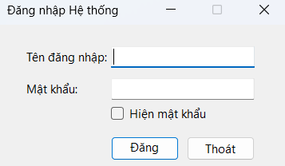
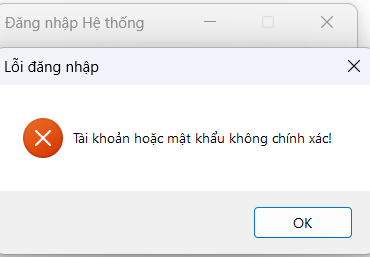
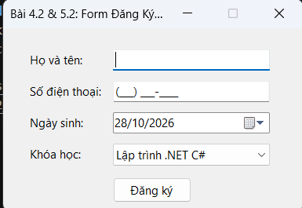
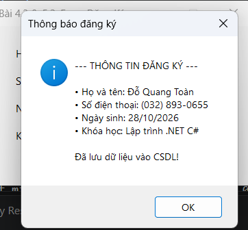

# BÁO CÁO BÀI TẬP THỰC HÀNH LẬP TRÌNH C# WINFORMS

## I. THÔNG TIN SINH VIÊN
- **Họ và tên:** Đỗ Quang Toàn
- **Mã số sinh viên:** 24810320100
- **Lớp học phần:** D19QTANM1 - Lập trình .NET
-- **Link Repository:** https://github.com/dtoan7150-maker/doquangtoanbai5152ngay28thang10
---

## II. DANH SÁCH BÀI TẬP HOÀN THÀNH & TỰ ĐÁNH GIÁ

| Bài tập | Tiêu đề bài tập | Trạng thái | Mức độ hoàn thành (%) |
| :---: | :--- | :---: | :---: |
| **Bài 4.1** | Xây dựng Login Form chuẩn UX (Validation ErrorProvider, Accept/Cancel Button, Hide Password) | Hoàn thành | 100% |
| **Bài 4.2** | Form Đăng ký học viên với các Input Controls (MaskedTextBox, DateTimePicker, ComboBox) | Hoàn thành | 100% |
| **Bài 5.1** | Nâng cấp Bài 4.1 kết nối và lưu trữ xác thực vào CSDL (SQLite) | Hoàn thành | 100% |
| **Bài 5.2** | Nâng cấp Bài 4.2 kết nối và lưu trữ danh sách học viên vào CSDL (SQLite) | Hoàn thành | 100% |

---

## III. MÔ TẢ CHI TIẾT & HÌNH ẢNH KẾT QUẢ (DEMO)

### 1. Bài 4.1 & 5.1: Form Đăng nhập (Login Form)
- **Tính năng:**
  - Kiểm tra Validation trống tài khoản/mật khẩu bằng `ErrorProvider`.
  - Phím **Enter** kích hoạt nút **Đăng nhập** (`AcceptButton`), phím **Esc** kích hoạt nút **Thoát** (`CancelButton`).
  - CheckBox **Hiện mật khẩu** toggle thuộc tính `UseSystemPasswordChar`.
  - Truy vấn kiểm tra tài khoản thực tế trong CSDL SQLite.

---

### 2. Bài 4.2 & 5.2: Form Đăng ký Học viên
- **Tính năng:**
  - MaskedTextBox quy định định dạng SĐT: `(000) 000-0000`.
  - DateTimePicker định dạng ngày sinh `dd/MM/yyyy`.
  - ComboBox nạp danh sách khóa học liên kết qua `DisplayMember` và `ValueMember`.
  - Đăng ký thành công sẽ lưu dữ liệu trực tiếp vào CSDL SQLite và hiển thị thông báo tổng hợp.

---

